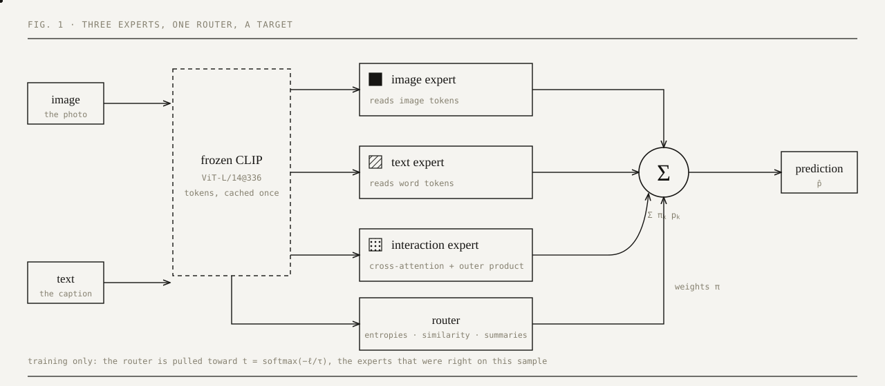

<p align="center">
  <picture>
    <source media="(prefers-color-scheme: dark)" srcset="assets/hero-dark.svg">
    
  </picture>
</p>

A multimodal classifier reads an image together with the text that comes with it. **Which of the two deserves trust changes from one input to the next**: sometimes the picture carries the meaning, sometimes the words do, sometimes only the two together, and sometimes one of them is missing or points the wrong way.

We route every input over three experts (image, text and their interaction) with a small router that is trained toward a **reliability target**: whichever expert was actually right on that sample. One temperature spans static fusion and hard expert selection. We then test, under a strict protocol, *when* that routing helps.

> **The short version.** On clean data, routing ties static fusion. When input quality varies from sample to sample, the router moves weight away from the damaged input and beats static fusion on three of six datasets. It is not the best method under mixed quality, and it can be fooled by a plausible but wrong input. We report all three.

**[Interactive paper](#4--try-it)** · **[Results](#2--what-we-found)** · **[Limits](#3--where-it-does-not-help)** · **[Reproduce](#5--reproduce)** · **[Repository map](#6--repository-map)**

---

### §1 · The idea

<p align="center">
  <picture>
    <source media="(prefers-color-scheme: dark)" srcset="assets/pipeline-dark.svg">
    
  </picture>
</p>

- **Frozen features.** CLIP ViT-L/14@336 turns the image into 144 pooled patch tokens plus a summary token, and the text into up to 77 word tokens. CLIP stays frozen and the features are cached once, so a training run takes about five minutes. Only the fusion head (4.5 M parameters) is trained.
- **Three experts.** An image expert, a text expert, and an interaction expert (two layers of image–text cross-attention plus an outer product of the two summaries).
- **A router.** It reads the two summary embeddings, each expert's uncertainty (entropy) and the image–text cosine similarity, and outputs weights π over the experts. The prediction is the π-weighted mixture of the experts' probabilities.
- **A reliability target.** Each expert's loss ℓ<sub>k</sub> on the true label says how reliable it was on that sample. A softmax at temperature τ turns the losses into a target, and a KL term pulls the router toward it.

<p align="center">
  <picture>
    <source media="(prefers-color-scheme: dark)" srcset="assets/temperature-dark.svg">
    
  </picture>
</p>

As τ → ∞ the target is uniform (static fusion). At τ = 1 it equals the E-step responsibility of a classical mixture of experts. As τ → 0 it picks the single best expert. One parameter spans all three, which is the sense in which the framework is *unified*. The equations are in [`docs/MATH_SPEC.md`](docs/MATH_SPEC.md).

---

### §2 · What we found

**Clean data: routing ties static fusion.** Test performance, mean over seeds (AUROC; accuracy for MVSA and Food-101). Dynamic is significantly better than static only on Harm-C, and slightly worse on Food-101.

| Method | FHM | Harm-C | Harm-P | MAMI | CrisisMMD | MVSA | Food-101 |
|---|---|---|---|---|---|---|---|
| Static fusion | 0.756 | 0.916 | 0.679 | 0.847 | 0.979 | 0.818 | 0.953 |
| QMF (ICML '23) | 0.731 | 0.924 | 0.668 | 0.862 | 0.981 | 0.819 | 0.948 |
| PDF (ICML '24) | 0.739 | 0.923 | 0.667 | 0.859 | 0.981 | 0.815 | 0.952 |
| **Dynamic (ours)** | **0.756** | **0.923** | **0.679** | **0.852** | **0.980** | **0.817** | **0.951** |
| Best 7B LMM, zero-shot | 0.742 | 0.788 | 0.652 | 0.829 | 0.902 | – | – |

**Broken inputs: the router moves.** In a test fixed before we ran it, a quarter of every split loses its image and another quarter loses its text. The weight on a modality falls when that modality is missing, on all six datasets. Mean weights on Harm-C:

| Harm-C test samples | π image | π text | π interaction |
|---|---|---|---|
| both inputs present | 0.651 | 0.183 | 0.166 |
| image missing | **0.031** | 0.795 | 0.174 |
| text missing | 0.901 | **0.042** | 0.057 |

**…and it pays off, sometimes.** Dynamic minus static, test AUROC, paired over ten seeds, Holm-corrected across the six datasets:

| Dataset | Dynamic | Static | Δ | Holm p | Seeds ahead |
|---|---|---|---|---|---|
| FHM | 0.6999 | 0.6935 | +0.0063 | 0.046 \* | 9 / 10 |
| Harm-C | 0.8999 | 0.8933 | +0.0066 | 0.013 \* | 8 / 10 |
| Harm-P | 0.6658 | 0.6638 | +0.0019 | 0.617 | 7 / 10 |
| MAMI | 0.8215 | 0.8154 | +0.0061 | 0.267 | 8 / 10 |
| CrisisMMD | 0.9672 | 0.9641 | +0.0031 | 0.013 \* | 8 / 10 |
| MVSA (accuracy) | 0.7886 | 0.7904 | −0.0017 | 0.646 | 5 / 10 |

**Cheap.** The fusion head is 4.5 M parameters and 0.6 GFLOPs per sample, against 362 GFLOPs for the frozen CLIP backbone. At batch size 1 on an NVIDIA L4, a full prediction takes about 68 ms; the two 7B models take 1.6 s and 3.8 s, so 23× to 56× lower latency, while scoring higher on five binary datasets. (That is a trained model against zero-shot models; say so when you compare.)

Every table is regenerated from the committed results by `python -m hmf.report`; the sources are in [`docs/tables/`](docs/tables).

---

### §3 · Where it does not help

- **Not the best method under mixed quality.** PDF or QMF has the higher mean on five of six datasets (their means are over 5 seeds, ours over 10); we are ahead only on FHM.
- **A router that reads confidence cannot tell a plausible input from a wrong one.** Swapping each Harm-C meme's image for another meme's costs dynamic fusion 0.158 AUROC more than static fusion (p < 0.001). The live demo's "mismatched text" condition shows the same behaviour: the router follows the wrong text.
- **Nothing transfers well across meme datasets** (off-diagonal AUROC 0.37–0.69 for every method), and most of the cost sits in the backbone, not the fusion head.
- **Our damage is synthetic.** The mixed-quality test is controlled; we have not shown the effect on naturally degraded data or outside image-plus-text.

---

### §4 · Try it

[`showcase/`](showcase) is an interactive paper: the project told as a scrolling page in ink on matte paper (light and dark), with a live demo of the trained Food-101 model. Give it a photo and a line of text, then break the input and watch the router's weights move: original, image removed, text removed, and mismatched text.

```bash
pip install -e ".[train]"                 # torch, transformers, pillow, ...
python -m showcase.app                    # http://127.0.0.1:8765
python -m showcase.app --explorer-only    # no model download; everything except the live demo
```

The first launch downloads CLIP ViT-L/14@336 (about 1.7 GB) into the Hugging Face cache; after that it works offline. To open it on a tablet over Wi-Fi, add `--host 0.0.0.0` (there is no password, so only on a network you trust). The meme datasets contain hateful content and cannot be redistributed, which is why the demo uses Food-101. Details and the display font note are in [`showcase/README.md`](showcase/README.md).

---

### §5 · Reproduce

```bash
pip install -e ".[train,dev]"
pytest -q                                  # CPU only, no data needed
```

The datasets are not included (licences, and hateful content). Obtain each from its official source, then:

```bash
python -m hmf.features.extract --dataset fhm --root ~/datasets/fhm ...     # frozen CLIP features, once
python -m hmf.train --config configs/fhm/dynamic.yaml                      # one seeded run, validation only
SEED=3 python -m hmf.train --config configs/fhm/dynamic.yaml
python -m hmf.evaluate --run-dir results/fhm/dynamic/seed0 --split val
python -m hmf.report                       # results/ -> docs/tables, docs/figures
```

Every training setting lives in the config, so the config hash covers the whole experiment. The test split can only be read through `hmf.evaluate --final`, and only for a configuration whose hash is listed in [`results/FINAL_CONFIGS.md`](results/FINAL_CONFIGS.md).

**The protocol in five lines** ([`docs/PROTOCOL.md`](docs/PROTOCOL.md)):
1. Train fits, validation chooses, test reports; the test split is read once per frozen configuration.
2. Hyperparameters come from a validation-only sweep with at most 50 trials per dataset and method family.
3. Ten seeds for the dynamic-versus-static comparison; paired *t*-tests with Holm correction.
4. The mixed-quality test is defined by a sample-ID hash, so every method, seed and epoch sees identical damage.
5. No method change was made after the test results were seen.

The result files in [`results/`](results) hold each run's exact config and metrics. The per-sample prediction CSVs (IDs and scores, no images or text) are not included here because of their size.

---

### §6 · Repository map

| Path | What it holds |
|---|---|
| [`hmf/`](hmf) | The package: data loaders, feature extraction, experts, router, fusion, baselines (QMF, PDF, Hate-CLIPper), evaluation and statistics |
| [`configs/`](configs) | One config per dataset and method; the exact settings behind every reported number |
| [`splits/`](splits) | Train, validation and test ID lists per dataset, and duplicate reports |
| [`results/`](results) | Per-run `metrics.json` and `config.yaml`; `FINAL_CONFIGS.md` |
| [`docs/`](docs) | Math specification, protocol, derivations, result tables and figures |
| [`showcase/`](showcase) | The interactive paper and the live demo |
| [`tests/`](tests) | About 700 tests (shapes, masks, gradients, the test-split guard, statistics) |

References to decision IDs such as D-027 point to an internal decision log that is not published; the rules that matter are written out in `docs/PROTOCOL.md`.

---

### §7 · Team

S Nafees · S Gaja Lakshmi · Saanvi S · Sachit P Naidu, under the guidance of **Rekha G S**, Assistant Professor, Department of Computer Science and Engineering, B.M.S. College of Engineering, Bengaluru.

This project rebuilds and extends our earlier paper, *A Unified Adaptive Framework for Multimodal Data Fusion with Dynamic Modality Reweighting*, under a stricter evaluation protocol.

**Cite as:** S. Nafees, S. Gaja Lakshmi, Saanvi S, S. P. Naidu and R. G. S. *A unified adaptive framework for multimodal data fusion with reliability-guided dynamic expert fusion.* B.M.S. College of Engineering, 2026.

**License:** none has been chosen yet; until one is added, all rights are reserved.
